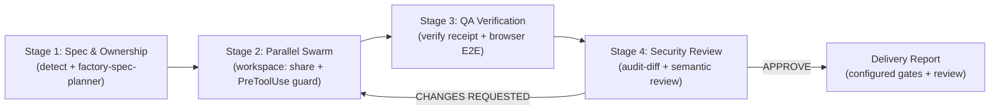

# Antigravity Harness

[](LICENSE)

**Antigravity Harness** is a specialized multi-agent development harness for solo developers working on a single machine, paired with a portable, zero-dependency Node.js CLI. Rather than building an external ticket-intake or queue-scheduling plant, it uses Antigravity's native agents, multi-agent swarm delegation, browser operation, and lifecycle controls—adding **Prompt, Context, and Harness Engineering** primitives for deterministic hooks, specialized skills, and isolated worktree workflows.

It pairs **probabilistic agent skills & context** (specification planning, disjoint slice contracts, isolated parallel swarm/worktree authoring, browser/E2E testing, and fresh-context semantic code review) with **deterministic runtime physics** (stack detection, test/build verification oracles with SHA-256 freshness receipts, holdout test guardrails, `file:line` diff security scanning, and `PreToolUse` / `Stop` lifecycle hooks).

---

## Prompt, Context, and Harness Engineering

Relying purely on conversational prompts or skills leads to probabilistic drift, context rot, test-cheating, and human-in-the-loop (HIL) interruption fatigue. Purely rigid scripts, on the other hand, cannot decompose product requirements, author full-stack slices, or reason about subtle semantic bugs.

**Antigravity Harness** structures solo-developer multi-agent workflows across three layers:

1. **Prompt Engineering (Probabilistic — Single Turn)**: Specialized skills (`factory-spec-planner`, `factory-pipeline`, `factory-qa-verifier`, `factory-security-reviewer`) and role-specific worker briefs that steer what each agent attempts.
2. **Context Engineering (Probabilistic — Session State)**: Always-on workspace rules (`rules/AGENTS.md`), detected stack inventories (`detect`), and machine-checked slice ownership contracts (`.factory/spec.json`) so builders and fresh-context reviewers see high-signal boundaries.
3. **Harness Engineering (Deterministic — Runtime Physics)**: `PreToolUse` guards (`pre-tool-guard.js`), bounded `Stop` verification circuit breakers (`stop-verify-gate.js`), binary pass/fail verification oracles (`verify`), holdout suite protection (`holdout/`), static diff scanners (`audit-diff`), and conflict-aware worktree integration (`land`).

| Concern | Probabilistic Layer (Prompt & Context Engineering) | Deterministic Layer (Harness Engineering: CLI & Hooks) |
| :--- | :--- | :--- |
| **Architecture & Planning** | `factory-spec-planner` locks shared contracts, acceptance criteria, and disjoint file slices | `agy-factory detect` inventories real stacks, `docker-compose.yml`, and runnable scripts |
| **Parallel Worktree Build** | `factory-pipeline` fans out isolated swarm workers (`workspace: "share"`) per slice | `PreToolUse` hook blocks writes to `.env`, private keys, `.git/`, holdout tests, and out-of-slice files |
| **QA & Verification Oracles** | `factory-qa-verifier` drives live UI user flows via the `browser` subagent | `agy-factory verify` enforces `NOT_RUN !== PASS` and writes `.factory/verify-receipt.json` |
| **Completion & Loop Bounds** | Portable `rules/AGENTS.md` requires verification before declaring done | Opt-in `Stop` hook checks configured status with a bounded per-conversation circuit breaker |
| **Fresh-Context Review** | `factory-security-reviewer` conducts read-only semantic review of `git diff` | `agy-factory audit-diff` flags hardcoded secrets, SQL interpolation, `eval`, and XSS sinks |



---

## Repository Layout

```text
.
├── .agents/
│   └── plugins.json                         # Workspace plugin discovery registration
├── AGENTS.md                                # Contributor & harness rules for this repo
├── package.json                             # Zero-dependency Node.js >=20 ESM manifest
├── bin/
│   └── agy-factory.js                       # Root CLI entrypoint -> plugin CLI
├── plugins/
│   └── antigravity-harness/                # Portable, self-contained Antigravity plugin
│       ├── plugin.json                      # Plugin manifest (skills, rules, hooks bundle)
│       ├── hooks.json                       # PreToolUse & Stop lifecycle hook wiring
│       ├── bin/
│       │   ├── agy-factory.js               # Standalone CLI (detect, plan, verify, audit-diff, land, twin, init)
│       │   ├── pre-tool-guard.js            # PreToolUse secret/git/command/slice guardrail
│       │   └── stop-verify-gate.js          # Bounded opt-in Stop verification gate
│       ├── lib/
│       │   ├── detect.js                    # Stack & component script discovery
│       │   ├── spec.js                      # Declarative .factory/spec.json slice validator
│       │   ├── verify.js                    # Deterministic runner & verify-receipt writer
│       │   ├── audit-diff.js                # Regex diff scanner & slice boundary checker
│       │   ├── land.js                      # Automated worktree slice auditor & lander
│       │   ├── twin.js                      # Digital Twin Universe (DTU) HTTP mock & webhook server
│       │   ├── formatters.js                # GitHub Markdown & SARIF v2.1.0 formatters
│       │   └── init.js                      # Antigravity plugin installer
│       ├── rules/
│       │   └── AGENTS.md                    # Portable always-on Antigravity Harness rules
│       └── skills/
│           ├── factory-pipeline/SKILL.md
│           ├── factory-spec-planner/SKILL.md
│           ├── factory-qa-verifier/SKILL.md
│           └── factory-security-reviewer/SKILL.md
├── examples/
│   └── task-tracker/                        # Reference full-stack app (Postgres + Express + React)
│       ├── docker-compose.yml
│       ├── db/init.sql
│       ├── api/                             # Node 20 + Express + pg REST API & unit tests
│       └── web/                             # React + Vite frontend served via Nginx
└── tests/
    ├── cli.test.js                          # Unit & subprocess tests for CLI commands
    ├── hooks.test.js                        # Unit & stdin/stdout tests for PreToolUse & Stop hooks
    └── pipeline-apps.test.js                # 8 E2E multi-stage pipeline & multi-agent test apps
```

---

## Local harness and distribution

Use one agent for small tasks and native Antigravity delegation only for independent slices. The plugin is not a scheduler, daemon, sealed evaluator or cross-platform adapter. Holdouts are guarded against selected modifications, not hidden. Receipts are unsigned local evidence.

- [Implementation status, validation results and qualification limits](docs/implementation-status.md)
- [Installable bundle and Marketplace preparation](docs/release.md)
- [Policy, evidence, status and recovery contract](docs/verification-contract.md)
- [Tested host compatibility and qualification limits](docs/compatibility.md)

From this clone, run `agy plugin validate ./plugins/antigravity-harness --strict` then `agy plugin install ./plugins/antigravity-harness` to install natively. This changes your Antigravity profile. Project-local `init --mode link|copy` is an alternative registration/setup route. Avoid duplicate registration. Build a standalone archive with `npm run package:plugin`.

## Quickstart

Requires **Node.js `>= 20.0.0`**. The harness CLI and plugin use zero external npm dependencies, so they run immediately without `npm install`. **Docker & Docker Compose are optional**—if `docker compose` is installed and a repository includes `docker-compose.yml`, `agy-factory verify` validates it automatically; if Docker is not installed (or no compose file exists), the check is recorded as `NOT_RUN` without blocking verification.

### 1. Run the Harness Test Suite & Self-Checks

```bash
# Run all CLI and lifecycle hook unit tests (node:test)
npm test

# Verify this repository with --require-tests and inspect .factory/verify-receipt.json
node bin/agy-factory.js verify --require-tests

# Run the deterministic security diff scanner across the workspace
node bin/agy-factory.js audit-diff
```

### 2. Run `agy-factory` Against the `examples/task-tracker` App

```bash
# 1. Detect multi-service stack (docker-compose.yml + api + web)
node bin/agy-factory.js detect --cwd examples/task-tracker

# 2. Requires installed app dependencies, Docker and Chromium: run configured live acceptance too
node bin/agy-factory.js verify --cwd examples/task-tracker --require-tests

# 3. Audit all files in the example app for secrets and injection sinks
node bin/agy-factory.js audit-diff --cwd examples/task-tracker --all
```

---

## CLI Reference (`agy-factory`)

Invoke via `node bin/agy-factory.js <command>`, `npx agy-factory <command>`, or directly from the portable plugin at `node plugins/antigravity-harness/bin/agy-factory.js <command>`.

### `agy-factory detect`

Scans a workspace root and 1-level service directories for `docker-compose.yml` / `compose.yaml` and Node.js (`package.json`), Python (`pyproject.toml` / `requirements.txt`), Go (`go.mod`), and Rust (`Cargo.toml`) components.

```bash
node bin/agy-factory.js detect [--cwd <dir>] [--json]
```

| Flag | Description |
| :--- | :--- |
| `--cwd <dir>` | Target workspace directory (defaults to `process.cwd()`). |
| `--json` | Emit structured JSON (`{ root, hasDockerCompose, dockerComposeFile, components }`). |

- **Exit code**: `0` on success.

---

### `agy-factory plan`

Scaffolds or validates a declarative slice ownership manifest (`.factory/spec.json`) so slice boundaries are machine-checked both during `PreToolUse` (`FACTORY_SLICE=<name>`) and at `audit-diff` / `land` time.

```bash
node bin/agy-factory.js plan [--cwd <dir>] [--init] [--slice <name>] [--json]
```

| Flag | Description |
| :--- | :--- |
| `--init` | Scaffold a starter `.factory/spec.json` auto-populated from detected workspace components. |
| `--slice <name>` | Inspect a single slice's `allowPaths`, `verifyCommand`, and `description`. |
| `--json` | Emit structured JSON (`{ ok, valid, errors, slices, spec }`). |

---

### `agy-factory status` and `evidence record`

`status --cwd <project> --json [--conversation <id>]` is read-only: exit 0 means VERIFIED, 1 means UNVERIFIED/FAILED/EXHAUSTED, and 2 means invalid configuration or invocation. Require specific component checks and browser/review evidence through `.factory.json`; see the [contract](docs/verification-contract.md).

Capture the returned subject/policy digests before inspection. After actual native browser or independent review work, use `evidence record --cwd <project> --kind browser|review --status PASS|FAIL --summary <text> --producer <text> --subject-digest <captured> --policy-digest <captured> [--artifact <path>]`. State changes invalidate recording. Producer text does not authenticate independence.

### `agy-factory verify`

Executes deterministic QA checks across the workspace and writes a versioned freshness receipt to `<cwd>/.factory/verify-receipt.json`.

```bash
node bin/agy-factory.js verify [--cwd <dir>] [--require-tests] [--skip-docker] [--format text|json|markdown] [--github-summary]
```

| Flag | Description |
| :--- | :--- |
| `--cwd <dir>` | Target workspace directory (defaults to `process.cwd()`). |
| `--require-tests` | Fail verification (`ok: false`, exit `1`) if zero component `test` checks achieve `PASS` (also honored via `.factory.json` `"requireTests": true`). |
| `--skip-docker` | Mark `docker-compose` validation as `NOT_RUN` instead of invoking `docker compose config`. |
| `--format <fmt>` | Output format: `text` (default), `json`, or `markdown` (GFM summary table). |
| `--github-summary` | Append a Markdown verification table directly to `$GITHUB_STEP_SUMMARY` in GitHub Actions. |
| `--json` | Shorthand for `--format json`. |

**Check Categories & Status Semantics:**
- `hygiene`: Verifies `.env` is ignored by `.gitignore` when present and no `.env` or private key files (`*.pem`, `id_rsa`) are tracked by git.
- `docker-compose`: Validates `docker compose config --quiet` when a Compose file exists (unless `--skip-docker`).
- Per-component `lint`, `typecheck`, `test`, `build`: Runs each configured command in the component directory (auto-installing missing `node_modules` when dependencies exist).
- **`PASS` / `FAIL` / `NOT_RUN`**: Unconfigured scripts report `NOT_RUN`, **never** `PASS`. When `--require-tests` is passed, `NOT_RUN` across all test slots fails the gate.
- **Exit codes**: `0` when `receipt.ok === true`; `1` when any check is `FAIL` or `--require-tests` is unsatisfied.

---

### `agy-factory audit-diff`

Scans modified and untracked text files (or all repository files) for high-risk security anti-patterns with exact `file:line` precision.

```bash
node bin/agy-factory.js audit-diff [--cwd <dir>] [--base <git-ref>] [--allow-paths <list>] [--slice <name>] [--all] [--format text|json|markdown|sarif] [--github-summary]
```

| Flag | Description |
| :--- | :--- |
| `--cwd <dir>` | Target workspace directory (defaults to `process.cwd()`). |
| `--base <git-ref>` | Include files changed relative to `<git-ref>` (`git diff --name-only <base>`) in addition to uncommitted status. |
| `--allow-paths <list>` | Comma-separated owned file/directory prefixes or globs (e.g., `"api/**,db/init.sql"`). Any changed file outside this set triggers a `high`-severity `slice-boundary-violation`. |
| `--slice <name>` | Look up `allowPaths` for `<name>` directly from `.factory/spec.json`. |
| `--all` | Scan all non-ignored text files in `<cwd>` rather than only changed/untracked files. |
| `--format <fmt>` | Output format: `text` (default), `json`, `markdown`, or `sarif` (SARIF v2.1.0 for GitHub Code Scanning). |
| `--github-summary` | Append a Markdown audit report directly to `$GITHUB_STEP_SUMMARY` in GitHub Actions. |
| `--json` | Shorthand for `--format json`. |

**Built-In Rules:**
- `slice-boundary-violation` (`high`): Modified or untracked file outside `--allow-paths <list>` when validating slice ownership.
- `hardcoded-secret` (`high`): Cloud access keys, private key headers, and inline secret/token/password assignments (ignoring documented local placeholders).
- `dangerous-exec` (`high`): Dynamic code execution via `eval` or the `Function` constructor.
- `sql-interpolation` (`high`): Unparameterized template-string value interpolation inside SQL queries.
- `xss-sink` (`medium`): Raw HTML injection properties and direct DOM `innerHTML` assignments.
- *Inline suppression*: Append `factory-audit-ignore` on intentional unit-test fixture lines (subject to manual audit in `factory-security-reviewer`).

**Statuses & Exit Codes:**
- `APPROVE_CANDIDATE` (exit `0`): Zero findings.
- `WARN` (exit `0`): Only `medium`-severity findings present; requires semantic review confirmation.
- `FLAGGED` (exit `1`): One or more `high`-severity findings present.

---

### `agy-factory land`

Audits an isolated worker `git worktree` against its assigned slice ownership (`--allow-paths` or `--slice`) and security rules, requires fresh worker verification, rejects divergent target/staged edits and symlink paths, then applies owned files and verifies the integrated workspace. Failed verification rolls back only unchanged lander writes; concurrent edits are preserved with recovery details. `--force` overrides regex findings only, never ownership/conflicts. Review the combined result afterward; no commit or push is implicit.

```bash
node bin/agy-factory.js land --worktree <dir> [--cwd <dir>] [--slice <name> | --allow-paths <list>] [--dry-run] [--force] [--json]
```

---

### `agy-factory twin`

Starts a zero-dependency **Digital Twin Universe (DTU)** behavioral HTTP mock & replay server (`node:http` + `node:crypto` HMAC webhook signing) for offline integration testing.

```bash
node bin/agy-factory.js twin [--routes <routes.json>] [--port <port>] [--json]
```

Control endpoints exposed by every Digital Twin server (`createTwinServer`):
- `GET /__twin/health`: Returns `{ ok: true, requestsCount }`.
- `GET /__twin/requests`: Returns all recorded requests (`method`, `path`, `query`, `headers`, `body`, `timestamp`).
- `POST /__twin/reset`: Clears recorded requests and resets stateful twin storage.

---

### `agy-factory init`

Installs and configures `antigravity-harness` into another repository across Antigravity / Git hooks.

```bash
node bin/agy-factory.js init [targetDir] [--mode link|copy] [--target agy] [--git-hook] [--json]
```

| Flag | Description |
| :--- | :--- |
| `targetDir` | Destination repository path (positional, defaults to `process.cwd()`). |
| `--mode <link\|copy>` | `link` (default) points `<targetDir>/.agents/plugins.json` at this repo's `plugins/` folder; `copy` vendors a standalone copy into `<targetDir>/.agents/plugins/antigravity-harness`. |
| `--target agy` | Optional compatibility flag; only Antigravity is supported. |
| `--git-hook` | Opt into the non-destructive Git pre-commit verification installer. |
| `--json` | Print installation paths as JSON. |

`init` also creates `<targetDir>/.factory.json` (`{ "enforceStopVerify": false, "requireTests": true }`) if missing and ensures `.factory/` is listed in `<targetDir>/.gitignore`.
- **Exit code**: `0` on success, `1` on invalid mode or filesystem error.

---

## Antigravity Lifecycle Hooks

When the `antigravity-harness` plugin is enabled, [hooks.json](plugins/antigravity-harness/hooks.json) registers two self-contained lifecycle hooks:

### 1. `PreToolUse` Guardrail (`factory-pre-tool-guard`)

Runs [pre-tool-guard.js](plugins/antigravity-harness/bin/pre-tool-guard.js) before `write_file`, `edit_file`, and `run_command`:
- **Secret & Git File Protection (`deny`)**: Blocks agent writes/edits to `.env` and `.env.*` (while explicitly allowing `.env.example`, `.env.sample`, `.env.template`, and `.env.test`), SSH/PEM private keys (`id_rsa`, `id_ed25519`, `*.pem`, `*.key`), and `.git/config` or `.git/HEAD`.
- **Receipt & Holdout Test Integrity (`deny`)**: Blocks direct `write_file` / `edit_file` calls targeting `.factory/**` (guarding supported tool writes to verification records; this is not a process sandbox) and protected holdout suites (`holdout/**` or `*.holdout.test.*` / `*.holdout.spec.*`).
- **Catastrophic Shell Protection (`deny`)**: Blocks destructive system commands such as `rm -rf /`, `rm -rf ~`, `mkfs.*`, and fork bombs.
- **Destructive Git Confirmation (`force_ask`)**: Requires explicit user confirmation before `git reset --hard`, `git push --force` / `-f`, or `git clean -fd` / `-fdx`.
- **Fail-Safe**: Malformed or unrelated payloads default to `{ "decision": "allow" }`.

### 2. Bounded Opt-In `Stop` Verification Reminder (`factory-stop-verify-gate`)

Runs [stop-verify-gate.js](plugins/antigravity-harness/bin/stop-verify-gate.js) when the agent goes idle (`terminationReason: "NO_TOOL_CALL"` and `fullyIdle: true`):
- **Opt-In Activation**: Off by default so exploratory chats are never interrupted. Enable per-repository by setting `"enforceStopVerify": true` in `.factory.json`, or per-session via environment variable `FACTORY_ENFORCE_STOP=1`.
- **Freshness Check**: Versioned status binds HEAD, staged index, working source bytes/modes, symlink target text, and policy. Both normal `model_stop` and legacy `NO_TOOL_CALL` payloads are supported. Passing checks do not stand in for required review/browser evidence.
- **Bounded Loop Protection**: `stop.maxContinuations` is 0–3 (default 1). Edits do not reset the conversation budget. Exhaustion allows the host to end while conversation-specific status remains `EXHAUSTED`; this is not successful completion. Host hook errors can fail open.
- **Mechanical completion**: Use `agy-factory status --json` (exit 0 only VERIFIED). VERIFIED describes configured requirements; independent semantic review remains a workflow step even when not configured as required evidence.

---

## Bundled Skills & Portable Rules

| Component | Path | Purpose |
| :--- | :--- | :--- |
| **Portable Rules** | `rules/AGENTS.md` | Always-on 5 Antigravity Harness rules (Plan, Isolate, Verify, Audit, Preserve Docs). |
| **`factory-pipeline`** | `skills/factory-pipeline/SKILL.md` | End-to-end 4-stage orchestrator across planning, parallel swarm, QA, and security review. |
| **`factory-spec-planner`** | `skills/factory-spec-planner/SKILL.md` | Runs `detect`, locks shared API/DB contracts, and emits a disjoint Slice Ownership Table. |
| **`factory-qa-verifier`** | `skills/factory-qa-verifier/SKILL.md` | Runs `verify --require-tests`, checks `PASS`/`FAIL`/`NOT_RUN` & receipt, and runs `browser` E2E QA. |
| **`factory-security-reviewer`** | `skills/factory-security-reviewer/SKILL.md` | Runs `audit-diff` (`file:line`) + read-only semantic diff audit (`APPROVE` / `CHANGES REQUESTED`). |

---

## Using This Repository as a GitHub Template

Clone the repository to try the harness, or copy it into a new repository to start a project. If your GitHub copy is configured as a template, you can also use **Use this template**.

1. Clone or create your project repository.
2. *(Optional)* Remove the reference demo app once you no longer need it:
   ```bash
   rm -rf examples/task-tracker
   ```
3. **Start building**: Open the repository in Antigravity—`.agents/plugins.json` automatically activates the `antigravity-harness` plugin, rules, lifecycle hooks, and `factory-*` skills for local verification and diff security audits.

---

## Installing & Reusing Across Existing Repositories

You can also attach `antigravity-harness` to any existing project using whichever workflow fits your team:

### Option A: Link into Another Repo (Local Development)

Registers this repository's `plugins/` folder in `<target-repo>/.agents/plugins.json` so updates propagate automatically:

```bash
node bin/agy-factory.js init /path/to/your-repo --mode link
```

### Option B: Copy Self-Contained Plugin into a Repo (Team / VCS)

Vendors `plugins/antigravity-harness/` directly into `<target-repo>/.agents/plugins/antigravity-harness` with zero external path dependencies, ready to commit to git:

```bash
node bin/agy-factory.js init /path/to/your-repo --mode copy
```

### Option C: Manual `.agents/plugins.json` Declaration

Add an entry pointing to the parent directory containing `antigravity-harness/` in your project's `.agents/plugins.json`:

```json
{
  "entries": [
    {
      "path": ".agents/plugins"
    }
  ]
}
```

### Option D: Machine-Global Antigravity Plugin

Install once for every workspace on your machine by copying the plugin bundle into your global Antigravity config directory:

```bash
mkdir -p ~/.gemini/config/plugins
cp -R plugins/antigravity-harness ~/.gemini/config/plugins/antigravity-harness
```

Once copied or registered via `.agents/plugins.json`, Antigravity discovers `antigravity-harness` automatically and activates its rules, lifecycle hooks, and `factory-*` skills on the next turn.

---

## License

Released under the [MIT License](LICENSE).
